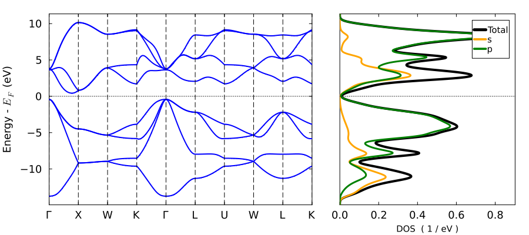

# tb3py - Python Wrapper for ThreeBodyTB.jl


This package is a simple python wrapper for
[ThreeBodyTB.jl](https://github.com/usnistgov/ThreeBodyTB.jl) that
makes installing and using the code within python easier. It is not
necessary to understand any [Julia](https://julialang.org/), and you
get full access to the code.

ThreeBodyTB.jl (see https://github.com/usnistgov/ThreeBodyTB.jl) is a
Julia package to perform tight binding calculations. It is based on
the method described in
[PhysRevMaterials.7.044603](https://journals.aps.org/prmaterials/abstract/10.1103/PhysRevMaterials.7.044603).

# Usage

[](https://colab.research.google.com/github/usnistgov/tb3py/blob/master/notebooks/tb3py_tutorial.ipynb)

The [documentation](https://pages.nist.gov/ThreeBodyTB.jl/) for
ThreeBodyTB.jl covers detailed usage of the main julia code. The python
wrapper can access any function from ThreeBodyTB.jl by prepending
`tb3.jl.` . For example, the exported function `makecrys` from ThreeBodyTB.jl can
be accessed as follows:

```
>>> import tb3py as tb3
>>> c = tb3.jl.makecrys("POSCAR_example")
>>> c
Julia:
Units: Å

A1=     2.60000  2.60000  0.00000
A2=     2.60000  0.00000  2.60000
A3=     0.00000  2.60000  2.60000

Si   0.00000  0.00000  0.00000
Si   0.25000  0.25000  0.25000

>>>
```
Using `tb3.jl.ThreeBodyTB.makecrys` also works, and that syntax works for non-exported functions.

An energy calculation and band structure calculation can be
performed as

```
>>> en, tbc, flag = tb3.jl.scf_energy(c)
>>> tb3.jl.plot_bandstr_dos(tbc)
>>> tb3.jl.savefig("t.pdf")
```
which will produce output like



Basically, you need to write `tb3.jl.` before normal julia commands. A tutorial introducing relevant commands for code users is available [here](https://pages.nist.gov/ThreeBodyTB.jl/ug_run/#Running-tight-binding-calculations), it should be possible to access all that functionality from python.

The code can also convert between numpy and julia objects fine. See:

```
>>> import numpy as np
>>> A = np.eye(3) * 10
>>> coords = np.zeros((1,3))
>>> atoms = ["Ga"]
>>> tb3.jl.makecrys(A, coords, atoms)
Julia:
Units: Å

A1=     10.00000  0.00000  0.00000
A2=     0.00000  10.00000  0.00000
A3=     0.00000  0.00000  10.00000

Ga   0.00000  0.00000  0.00000

>>>
```

### Overloaded operators (slightly advanced)

In some cases `ThreeBodyTB` can use overloaded operators to manipulate crystal structures, including generating supercells and scaling by a constant. It is possible to access this syntax in python using `seval` like this:
```
>>> from juliacall import Main as jl
>>> jl.c = c #c is a crystal object visible to python, we are making it visible to jl
>>> jl.seval("(c * 3.0)")
Julia:
Units: Å

A1=     7.80000  7.80000  0.00000
A2=     7.80000  0.00000  7.80000
A3=     0.00000  7.80000  7.80000

Si   0.00000  0.00000  0.00000
Si   0.25000  0.25000  0.25000

>>> jl.seval("(c * [2,2,2])")
Julia:
Units: Å

A1=     5.20000  5.20000  0.00000
A2=     5.20000  0.00000  5.20000
A3=     0.00000  5.20000  5.20000

Si   0.00000  0.00000  0.00000
Si   0.12500  0.12500  0.12500
Si   0.00000  0.00000  0.50000
Si   0.12500  0.12500  0.62500
Si   0.00000  0.50000  0.00000
Si   0.12500  0.62500  0.12500
Si   0.00000  0.50000  0.50000
Si   0.12500  0.62500  0.62500
Si   0.50000  0.00000  0.00000
Si   0.62500  0.12500  0.12500
Si   0.50000  0.00000  0.50000
Si   0.62500  0.12500  0.62500
Si   0.50000  0.50000  0.00000
Si   0.62500  0.62500  0.12500
Si   0.50000  0.50000  0.50000
Si   0.62500  0.62500  0.62500
```

# Installation

To install, clone the repository and run a setup command.

```
git clone git@github.com:usnistgov/tb3py.git
cd tb3py
pip install -e .

export JULIA_NUM_THREADS=1
export PYTHON_JULIACALL_HANDLE_SIGNALS=yes
```

This will install julia if necessary to run the backend (julia version
1.12+ is necessary). The code will take a while to install and
precompile (10+ minutes) the first time you import it. This process
should cache the most computationally expensive compilation, but there
will still be a small delay the first time you run a function in a
given session.

The two environment variables are to prevent issues with
multithreading between python and Julia.


# Author, Links, Release Notes

### Links

- [Main github of ThreeBodyTB.jl](https://github.com/usnistgov/ThreeBodyTB.jl)
- [Paper: PhysRevMaterials.7.044603](https://journals.aps.org/prmaterials/abstract/10.1103/PhysRevMaterials.7.044603)
- [Main documentation](https://pages.nist.gov/ThreeBodyTB.jl/) 
- [Main tutorial](https://pages.nist.gov/ThreeBodyTB.jl/ug_run/#Running-tight-binding-calculations) 
- [My NIST page](https://www.nist.gov/people/kevin-garrity)


### Release notes

There was a major breaking reorg of this code on 10/27/2026. The previous version is archived under branch `old_version`.

### Author

Good luck. Let me know if you have any problems.

kevin.garrity@nist.gov  
Kevin F. Garrity  
Material Data Division: 641.03  
Material Measurement Laboratory  
National Institute of Standards and Techonology (NIST)  
Gaithersburg, MD  
